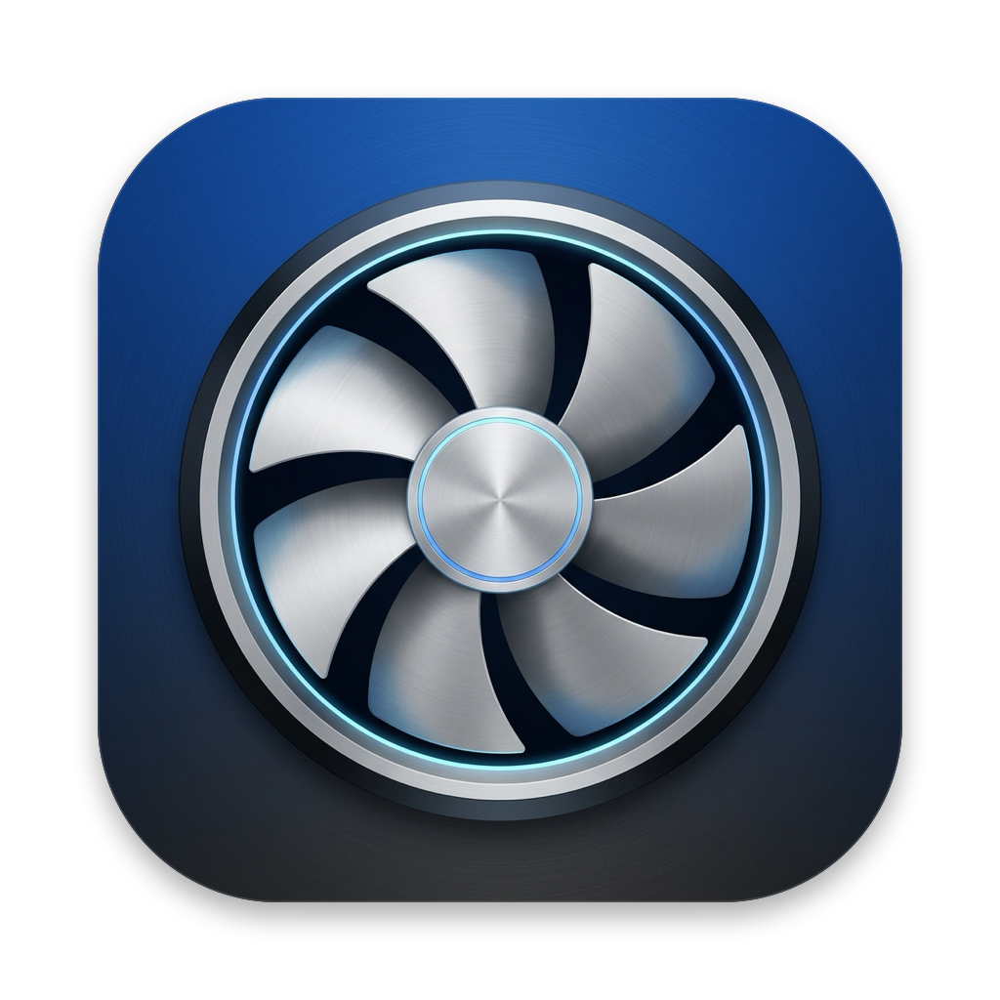
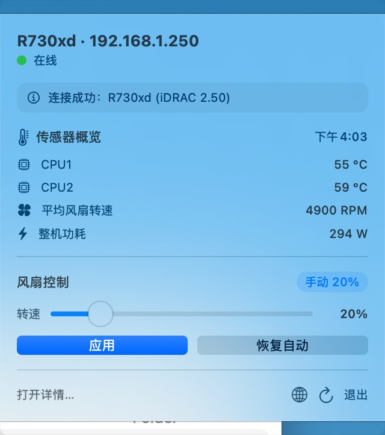
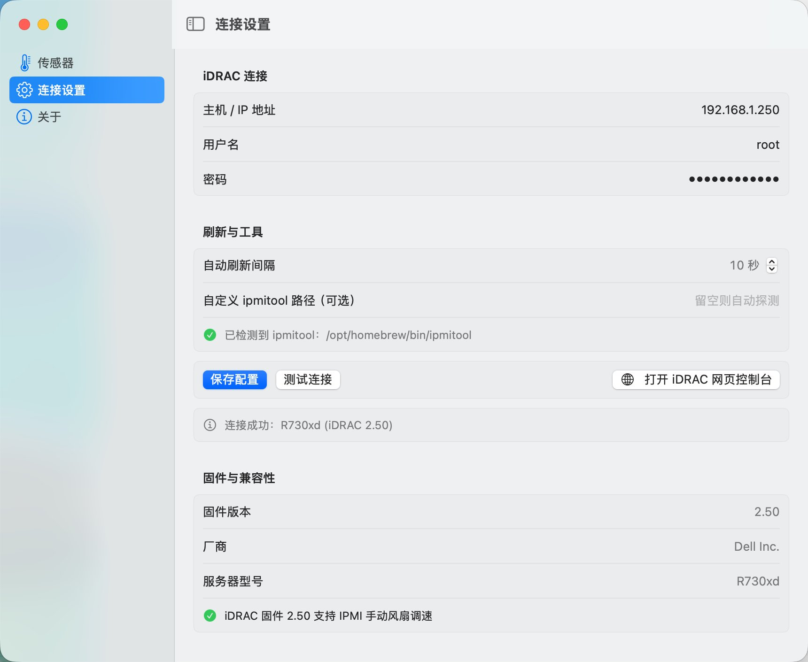

<div align="center">
  
  <h1>Dell Fans Controller for macOS</h1>
  <p>面向 macOS 的戴尔（Dell PowerEdge）服务器风扇转速控制与传感器监控工具</p>

  <p>
    
    
    
    <a href="LICENSE"></a>
  </p>
</div>

通过 IPMI over LAN 连接 iDRAC，常驻系统菜单栏实时显示温度，支持手动设定风扇转速百分比、一键恢复自动调速以及查看服务器传感器详情。

---

## 界面预览

<table>
  <tr>
    <td align="center" valign="top">
      
      <br />
      <sub>菜单栏快捷面板</sub>
    </td>
    <td align="center" valign="top">
      
      <br />
      <sub>连接设置与固件兼容性检测</sub>
    </td>
  </tr>
</table>

---

## 功能特性

- **菜单栏常驻**：顶部菜单栏实时显示当前温度，点击展开快捷控制面板（不在 Dock 栏占位）。
- **手动调速 / 恢复自动**：滑块设定转速百分比（应用前自动关闭 iDRAC 自动调速），支持一键恢复自动模式；低转速（< 20%）提供过热风险提示。
- **传感器监控**：解析并展示温度（Temp）、风扇（RPM）、电压（Voltage）、电流（Current）、功耗（Power）传感器，支持分类筛选与关键词搜索。
- **定时自动刷新**：可配置刷新间隔（3–300 秒），后台自动拉取最新传感器数据。
- **固件兼容性检测**：自动读取 `mc info` 与机型信息，遇到不支持手动调速的新版本固件时给出明确提示。
- **安全凭据存储**：iDRAC 密码保存在 macOS 钥匙串（Keychain）中，并通过 `IPMI_PASSWORD` 环境变量（`-E` 参数）传给 `ipmitool`，不出现在命令行参数与进程列表里。
- **快捷打开控制台**：一键在浏览器中打开 iDRAC 网页管理界面。
- **通用架构（Universal）**：原生支持 Apple Silicon（M 系列）与 Intel Mac（macOS 13 及以上）。

---

## 支持范围

| 平台 | 常见服务器代数 | 手动调速支持 |
|---|---|---|
| iDRAC6 / iDRAC7 / iDRAC8 | 11–13 代（R610/R710、R620/R720、R630/R730 等） | ✅ 支持 |
| iDRAC9 固件 ≤ `3.30.30.30` | 14 代（R640/R740 等） | ✅ 支持 |
| iDRAC9 固件 ≥ `3.34.34.34` / iDRAC10 | 14 代新固件、15/16 代等 | ❌ 不支持（仅检测并提示） |

> 原因说明：Dell 在 iDRAC9 `3.34.34.34` 及更高版本固件中从服务端封禁了 `raw 0x30 0x30` 手动调速命令，客户端无法绕过。

---

## 前置准备

1. **在服务器 iDRAC 中开启 IPMI over LAN**  
   登录 iDRAC 网页控制台 → **iDRAC 设置 / 网络 → IPMI 设置** → 启用 **IPMI over LAN**。
2. **在 Mac 上安装 `ipmitool`**  
   ```bash
   brew install ipmitool
   ```
   > 应用会自动检测 `/opt/homebrew/bin/ipmitool`、`/usr/local/bin/ipmitool` 及 `PATH` 中的 `ipmitool`，也可在设置页手动指定路径。

---

## 安装与首次打开（重要）

1. 从 [Releases](https://github.com/elias-zhao/dell_fans_controller_mac/releases) 下载 `DellFansController-v*-macOS-universal.dmg`（或 `.zip`）。
2. 将 `DellFansController.app` 拖入 **应用程序（`/Applications`）** 文件夹。
3. **解除开源未公证应用拦截（仅首次需要）**  
   由于本项目为免费开源软件，未使用付费 Apple Developer 证书签名和公证，从网络下载后 macOS Gatekeeper 会提示“无法验证开发者”或“已损坏”。请在终端运行一次以下命令清除下载隔离标记：
   ```bash
   xattr -cr /Applications/DellFansController.app
   ```
   （也可以先尝试打开一次，再到 **系统设置 → 隐私与安全性** 底部点击 **仍要打开**。）

---

## 快速使用

1. 打开 `DellFansController.app` 后，**Dock 栏不会显示图标**，请在屏幕顶部右侧**菜单栏**找到风扇图标。
2. 点击菜单栏图标 → **打开详情…** → 进入 **连接设置**。
3. 填写 iDRAC IP、用户名（通常为 `root`）和密码，点击 **测试连接** 确认在线及固件兼容性。
4. 之后即可随时通过菜单栏面板拖动滑块设定风扇转速、点击 **应用** 或 **恢复自动**，并在 **传感器** 页面查看实时硬件状态。

---

## 从源码构建

环境要求：macOS 13+、Xcode（或完整 Swift 工具链）。

```bash
# 运行单元测试
DEVELOPER_DIR=/Applications/Xcode.app/Contents/Developer swift test

# 构建 Universal (arm64 + x86_64) .app、.zip 与 .dmg（输出在 build/ 目录）
./scripts/build-app.sh

# 仅构建本机调试版 .app
./scripts/build-app.sh --debug
```

---

## 常见问题

- **提示“未找到 ipmitool 命令”**  
  请确认已执行 `brew install ipmitool`，或在 **连接设置 → 自定义 ipmitool 路径** 中填入 `which ipmitool` 的输出路径。
- **更新版本后提示访问钥匙串**  
  因采用本地 ad-hoc 签名，替换新版 App 后首次读取 Keychain 密码时系统会弹出授权框，点击 **始终允许** 即可。
- **关于风扇安全**  
  手动将转速固定在过低百分比存在硬件过热风险，请结合自身环境温度与 CPU 负载合理设置，并在不需要时恢复 iDRAC 自动模式。

---

## 开源协议

本项目基于 [Apache License 2.0](LICENSE) 开源。
